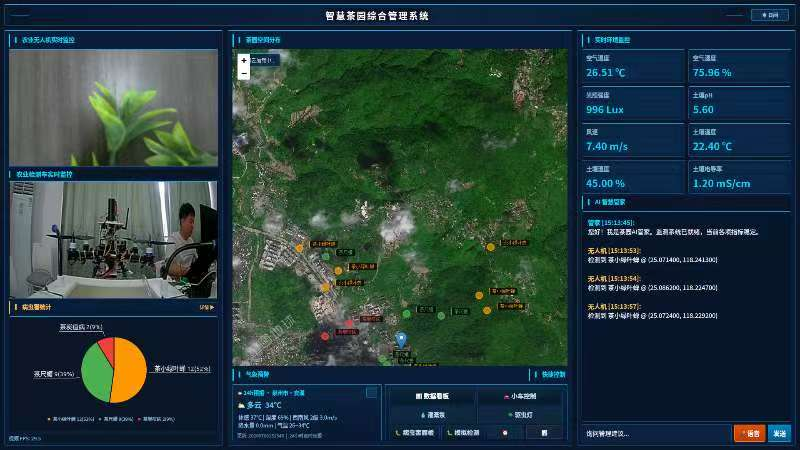
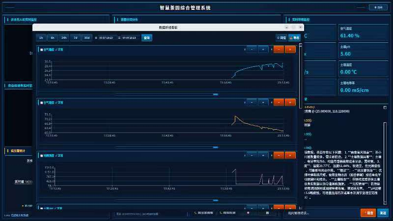
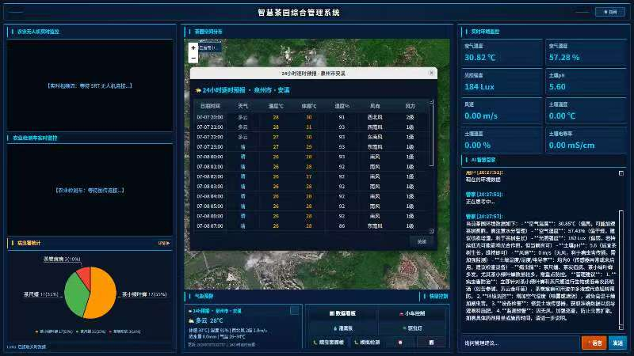

# 智慧茶园综合管理系统 V1.0 操作手册

## 一、相关文档

| 文档名称 | 指向资料 | 说明 |
| --- | --- | --- |
| 总体设计 | 《智慧茶园综合管理系统 总体设计》 | 说明软件整体结构、模块划分、运行环境和业务范围。 |
| 详细设计 | 《智慧茶园综合管理系统 详细设计》 | 说明各功能模块的界面布局、数据处理流程和接口定义。 |
| 测试案例 | 《智慧茶园综合管理系统 测试案例》 | 记录主要功能模块的操作场景、预期结果和异常处理验证。 |

## 二、说明

智慧茶园综合管理系统（以下简称"本系统"）是一套运行于RK3588边缘计算设备的茶园管理软件，版本号V1.0。软件面向茶园日常管理的实际需要，将环境数据采集、视频监控、病虫害识别、设备控制和AI咨询等功能集成在一个全屏操作界面中，供茶园管理人员和农业技术人员在日常巡检、环境监控、灌溉调度和病虫害防治等工作中使用。

软件通过LoRa无线通信模块连接部署在茶园中的环境传感器节点，采集空气温湿度、光照强度、风速、土壤湿度、土壤温度、土壤电导率和土壤pH值共八项环境指标，在主界面左侧面板以数据卡片形式每三秒刷新一次。采集到的数据同时存入设备本地SQLite数据库，可供后续查看历史趋势和导出分析。

视频监控方面，软件通过SRT协议接收农业无人机传回的H.264视频流，利用RK3588芯片内置的硬件解码器实时播放。地面检测车的USB摄像头画面同样在主界面视频区域显示。无人机和检测车的视频画面会被送入芯片内置的NPU（神经网络处理器），运行YOLO深度学习模型，对画面中的茶树叶片病虫害进行实时检测。目前模型可识别茶藻斑病、茶炭疽病、茶灰斑病、茶小绿叶蝉、茶红叶斑和健康叶片共六类目标。检测结果与无人机实时GPS位置绑定后，在高德地图上以彩色标记点展示，方便管理者快速定位病虫害发生区域。

设备控制方面，软件通过同一LoRa无线链路向田间控制器发送指令，控制灌溉泵的启动和停止、驱虫灯的开关。控制方式有四种：在主界面直接点击泵或灯的开关按钮进行手动操作；在定时管理对话框中设置按星期多时段的自动执行计划；当某项环境指标超出预设阈值时自动触发设备动作并弹出告警；以及接收华为云IoTDA平台远程下发的控制命令。灌溉泵运行时，主界面左侧会显示流量状态卡片，实时更新已灌溉水量、预计总灌溉量和剩余时间。

软件右侧面板设有AI对话区，接入DeepSeek大语言模型。使用者可以用文字输入问题，也可以点击语音按钮对着麦克风说话，系统通过SenseVoice语音识别将语音转为文字后发送给AI。AI可以根据当前传感器数据和病虫害检测情况，给出茶园管理建议、灌溉方案参考和病虫害防治指导。

此外，软件内置了HTTP服务器和WebSocket服务，同一局域网内的电脑或手机可以通过浏览器打开监控页面，实时查看传感器数据和设备状态。配套的微信小程序客户端通过华为云API获取茶园数据，支持远程查看和控制。

## 三、功能特点

本系统围绕茶园日常管理的实际流程，提供以下功能。

**环境数据实时监控。** 软件主界面启动后自动显示八张环境数据卡片，分别对应风速、空气温度、空气湿度、光照强度、土壤湿度、土壤温度、土壤电导率和土壤pH值。每张卡片上显示传感器名称、当前测量数值和计量单位。数值通过LoRa无线网络从田间传感器节点传回，每三秒刷新一次。卡片背景和数据文字颜色随数值变化：正常范围内显示白色文字，当某项数值超出预设的上下限阈值时，对应卡片的数值文字变为红色，同时操作系统桌面右下角弹出告警气泡，提醒管理者注意异常。

**无人机与检测车视频监控。** 软件通过SRT协议接收农业无人机传回的H.264视频流，利用RK3588芯片的h264_rkmpp硬件解码器解码后在主界面右侧上方播放。地面检测车通过USB连接传输摄像头画面，同样在右侧视频区域显示。由于SRT协议具有低延迟和抗丢包特性，无人机视频画面在网络波动时仍能保持基本流畅。无人机和检测车视频同时工作在独立线程中，互不干扰。

**AI病虫害检测与地图标注。** 无人机和检测车的视频画面帧每隔约三分之一秒被送入RK3588芯片的NPU进行YOLO深度学习推理。模型经过INT8量化后部署在NPU上，三核并行处理。检测到病虫害时，画面帧上会用彩色矩形框框出病灶位置，并在框上方标注病虫害种类名称，该帧画面在视频区域保持显示约两秒。检测结果同时记录病虫害种类、检测数量、当前无人机GPS经纬度和检测时间，存入本地数据库，并在高德地图对应坐标位置添加标记点。同一位置（水平距离0.5米以内）的同种病虫害不会重复记录，避免多次拍摄同一植株造成的重复计数。在地图上点击任意标记点，可查看该位置的病虫害种类、数量和检测时间。

**灌溉泵与驱虫灯控制。** 软件提供四种控制灌溉泵和驱虫灯的方式。手动控制最简单：在主界面左侧设备控制区点击灌溉泵开关按钮（蓝色表示开启、灰色表示关闭），或点击驱虫灯开关按钮（黄色表示开启、灰色表示关闭），LoRa模块即向田间控制器发送开关指令。按钮之间有约0.8秒的防抖间隔，连续快速点击时只有第一次生效，防止指令冲突。定时控制通过点击泵或灯按钮旁边的时钟图标进入定时计划管理对话框，可以设置按星期循环的自动执行时间表，例如每周一至周五上午八点灌溉三十分钟。阈值联动控制需要先在阈值设置对话框中为各传感器设定上下限，当某项环境数据超出设定范围时，系统可自动触发对应设备动作。云端远程控制由华为云IoTDA平台下发命令，软件接收后执行并返回执行结果，云端命令的优先级高于本地定时计划，收到云端命令时会暂停当前定时任务。

**传感器历史数据折线看板。** 点击主界面左侧的数据看板按钮，弹出独立窗口，以八张可折叠的折线图分别展示八项传感器的历史变化趋势。窗口顶部提供时间范围选择工具栏：可以点击"1小时""6小时""24小时""7天""30天"预设按钮快速切换，也可以在起始时间和结束时间选择器中自定义查询时段。每张折线图卡片可通过点击标题栏折叠或展开，卡片右下角有拖拽手柄可以调整卡片高度。图表中蓝色折线为传感器数值曲线。如果设置了阈值，图表中会显示红色虚线标注上下限位置，超出阈值的数据点以红色大号圆点突出标记。窗口底部有横向滚动条，在查看长时间范围数据时左右拖动可浏览细节。点击"导出Excel"按钮，可将当前时间范围内的全部八项传感器数据导出为一个Excel工作簿文件。

**AI对话咨询。** 主界面右侧下方是AI对话区。在底部的文字输入框中键入问题（例如"当前土壤湿度偏低，建议灌溉多长时间"），按回车键或点击发送按钮，问题发送至DeepSeek大语言模型，AI回复内容以聊天气泡形式显示在上方的对话显示区。用户发出的消息靠右对齐、AI回复靠左对齐，按时间顺序从上到下排列。也可以点击麦克风按钮开始对着麦克风说话，录音过程中再次点击麦克风按钮停止录音，录音文件自动通过SenseVoice语音识别转为文字后发送给AI。

**天气预警。** 主界面中间区域的天气卡片显示从星图云气象接口获取的当前天气预警等级和简要内容。点击天气卡片可以展开查看未来二十四小时逐小时天气预报详情，包括温度变化曲线和降水概率。

**地面检测车遥控。** 点击主界面左侧的小车控制按钮，弹出独立的检测车控制面板窗口。窗口上半部分实时显示检测车USB摄像头拍摄的前方画面（640×480像素）。下半部分以十字形排列五个控制按钮：前进、后退、左转、右转和喷水。既可以用鼠标按住屏幕按钮操作（按住期间持续发送运动指令，松开后停止），也可以直接用键盘W、A、S、D键控制方向，T键开始喷水、F键停止喷水。键盘按键同样采用按住有效、松开停止的逻辑。方向指令通过LoRa无线发送至检测车，松开按键后有短暂的防抖延迟确保指令正确终止。

**浏览器远程监控与微信小程序。** 软件启动后在内置HTTP服务器（端口8080）和WebSocket服务（端口8081）上监听，同一局域网内的设备通过浏览器访问设备IP地址加端口号即可打开监控页面，实时查看传感器数值、设备开关状态。WebSocket连接用于推送实时数据更新。配套的微信小程序通过华为云IoTDA的HTTPS API接口获取数据和控制设备，适合管理者不在茶园现场时使用。

## 四、系统要求

运行本软件需要以下硬件和软件条件。

| 项目 | 最低要求 | 推荐配置 |
| --- | --- | --- |
| 硬件平台 | ELF2-RK3588 ARM64开发板，4核Cortex-A76 + 4核Cortex-A55，3核NPU | 同最低要求，8GB及以上内存，32GB及以上存储 |
| 操作系统 | Ubuntu 22.04 ARM64或其他兼容的Linux ARM64发行版 | Ubuntu 22.04 ARM64及以上版本 |
| 外部设备 | LoRa串口通信模块（连接至/dev/ttyUSB*）、显示器（HDMI或MIPI接口） | LoRa模块、USB摄像头（用于检测车视频）、7寸及以上显示器 |
| 软件依赖 | Qt 5.15及以上、OpenCV 4.x、FFmpeg（编译时需包含h264_rkmpp和libsrt支持）、Paho MQTT C和C++库、RKNN Runtime（瑞芯微NPU推理运行时） | 与最低要求相同 |
| 网络 | 局域网连接（LoRa传感器通信和Web远程监控使用）；互联网连接（MQTTS上云、天气预报获取和AI对话功能需要） | 稳定的互联网连接，建议上行带宽不低于1Mbps |

## 五、主界面仪表盘

主界面仪表盘是软件启动后自动进入的全屏操作页面，也是使用者每天面对的主要工作界面。整个界面分为左、中、右三栏。

左侧面板上半部分排列着八张环境数据卡片。每张卡片的顶部显示传感器名称（如"空气温度""土壤湿度"），中间以大号字体显示当前数值和单位，数值每三秒自动更新一次。卡片颜色按功能分组：风速和光照相关卡片为蓝色调，空气温湿度卡片为青色调，土壤相关四张卡片为绿色调。卡片下方是LoRa连接状态标签，显示当前串口设备路径和通信波特率（如"/dev/ttyUSB0 9600"），如果串口断开或数据长时间未更新，标签文字会变为红色提示。状态标签下方依次排列数据看板、病虫害和小车控制三个功能按钮。再往下是设备控制区：灌溉泵开关按钮（开启时蓝色高亮、关闭时灰色）和驱虫灯开关按钮（开启时黄色高亮、关闭时灰色），每个按钮右侧有一个小时钟图标，点击后进入该设备的定时计划管理对话框。当灌溉泵处于运行状态时，控制区下方会出现一张流量状态卡片，卡片中以大号数字显示已灌溉水量（单位：升），下方一行显示预计总灌溉量和剩余时间，中间是一条彩色进度条直观表示灌溉进度，卡片底部有停止灌溉按钮和流速设置按钮。

中间面板上方嵌入高德地图。地图初始缩放级别和中心点定位在茶园所在区域。当YOLO检测到病虫害后，地图上对应GPS坐标位置会出现彩色圆形标记点，不同颜色代表不同病虫害种类。使用者可以像操作普通网页地图一样拖拽移动、滚轮缩放。地图下方是天气预警卡片，显示从星图云接口获取的预警等级（如"黄色预警"）和简要说明文字（如"预计未来6小时有强降雨"）。点击天气卡片会弹出一个新窗口，以列表形式展示未来二十四小时逐小时的天气预报数据，包括温度、天气状况和降水概率。

右侧面板上方播放无人机SRT视频画面。视频在独立解码线程中运行，通过拉取模式取最新帧显示，画面延迟通常为一帧以内。当YOLO检测到病虫害时，带有检测框和类别标签的画面帧会替代原始画面显示约两秒，给使用者足够时间看清检测结果，之后恢复显示原始实时画面。右侧面板下方是AI对话区：上半部分为对话显示区域，按时间顺序以聊天气泡展示对话历史；下半部分为输入区域，包含一个文字输入框、一个发送按钮和一个麦克风语音按钮。

在界面上进行设备操作时，点击泵或灯的开关按钮后，按钮颜色和文字立即切换，LoRa无线指令同时发出。按钮之间有约0.8秒的防抖保护，在短时间内连续点击同一按钮时只有第一次生效。灌溉泵开启后，已灌溉水量从零开始计数，每秒更新一次，数据基于预设流速乘以已运行时间计算得出。点击停止按钮或灌溉计划时长到达后，泵关闭，流量卡片保存最终灌溉量数据后收起。

AI对话的使用方式是：在输入框中打字后按回车或点发送，文字以右对齐气泡出现在对话区，AI的回复以左对齐气泡出现。点击麦克风按钮后对着麦克风说话，说完后再次点击按钮停止，录音文件自动转为文字发送。

## 六、数据折线看板

从主界面左侧面板点击数据看板按钮，弹出一个独立的折线看板窗口。窗口默认显示最近一小时内八项传感器各自的历史数据折线图。

窗口顶部是时间范围工具栏。左侧排列着"1小时""6小时""24小时""7天""30天"五个预设按钮，当前选中的按钮以高亮颜色标识。右侧是自定义查询区域：一个起始时间选择器（包含日期和时间）、一个结束时间选择器、一个查询按钮。选择好时间范围后点击查询，八张图表同步刷新。起始时间不能晚于结束时间，否则查询不会执行。

工具栏下方是八张可折叠的图表卡片，按风速、空气温度、空气湿度、光照强度、土壤湿度、土壤温度、土壤电导率、土壤pH的顺序排列。每张卡片顶部有一条标题栏，左侧显示传感器名称，右侧有一个折叠/展开箭头图标。点击标题栏任意位置，该卡片会折叠收起（只保留标题栏可见），再次点击展开。当需要集中查看某几张图时，可以把暂时不关注的图表折叠起来，给其他图表腾出更多屏幕空间。卡片右下角有一个三角形拖拽手柄，用鼠标按住并上下拖动可以调整该卡片的高度，方便放大感兴趣的图表。

每张折线图内部，横轴为时间，纵轴为传感器数值。传感器数据点按时间顺序连成蓝色折线。如果使用者在阈值设置中为该传感器配置了上下限，图表中会用红色虚线画出上限线和下限线。凡是数值超出阈值范围的数据点，会用红色大号圆点标记在折线上方，一眼就能看出异常发生的时间点和持续范围。

工具栏右侧有阈值设置按钮和导出Excel按钮。点击阈值设置按钮会打开阈值设置对话框（详见第九章）。点击导出Excel按钮，系统会弹出一个文件保存对话框让使用者选择保存位置和文件名，然后将当前时间范围内的全部传感器数据写入一个Excel工作簿文件，每个传感器占一个工作表。

窗口底部有一条横向滚动条。当查询范围较大（例如30天）、数据点密集时，八张图表的横轴会自动变长，底部的滚动条也随之变化，拖动滚动条可以左右平移查看不同时间段的数据细节。八张图表的横轴范围是同步联动的，拖动滚动条时所有图表一起平移。

## 七、病虫害监测看板

从主界面左侧面板点击病虫害按钮，弹出病虫害监测看板窗口。这个窗口汇总展示了YOLO检测模型自软件启动以来识别到的全部病虫害记录。

窗口顶部以大号数字显示累计检测到的病虫害总次数。下方左右分为两个区域：左侧是病虫害种类分布饼图，右侧是检测记录明细表格。

饼图将不同病虫害种类用不同颜色区分（如茶藻斑病为绿色、茶炭疽病为棕色、茶灰斑病为灰色、茶小绿叶蝉为黄色、茶红叶斑为红色、健康叶片为蓝色），每个扇形的大小代表该种类在全部检测记录中的占比。鼠标悬停在任意扇形上会浮现文字提示，显示该种类的名称和检测次数。

右侧表格每一行对应一条检测记录，从左到右的列依次为：记录序号、病虫害种类名称、当次检测到的该种类数量、GPS纬度坐标、GPS经度坐标和检测时间（精确到秒）。表格支持上下滚动浏览。由于系统对同一位置0.5米范围内的同种病虫害做了自动去重处理，表格中不会出现大量坐标相近、种类相同的重复记录。

窗口底部有清除数据按钮。点击后会弹出确认对话框，询问"确定要清除所有病虫害记录吗？"，点击确定后数据库中的病虫害记录、表格内容和饼图数据全部清空。这个操作不可撤销，建议在确认数据已备份或不再需要后才执行。

关闭窗口后再次打开，表格和饼图会自动加载数据库中的最新记录。如果在关闭期间有新的病虫害被检测到，重新打开窗口时会反映在统计数字和表格中。

## 八、地面检测车控制面板

在主界面左侧面板点击小车控制按钮，弹出检测车控制面板。这个独立窗口用于遥控地面检测车在茶园中行进和执行喷水作业，同时实时查看检测车前方视野。

窗口上半部分占据约三分之二的面积，显示检测车USB摄像头传输的实时画面，分辨率640×480像素，帧率约15到25帧。画面延迟通常在100到200毫秒之间。视频采集通过Linux系统的V4L2框架和ffmpeg管道实现，在独立进程中运行。

窗口下半部分是控制按钮区域。四个方向按钮以十字形排列：上方为前进按钮（▲）、下方为后退按钮（▼）、左侧为左转按钮（◀）、右侧为右转按钮（▶）。十字形中心下方是喷水按钮（💧）。按钮操作支持两种方式：鼠标按住屏幕按钮，按住期间检测车持续朝该方向运动，松开后停止；键盘操作按W前进、S后退、A左转、D右转，按住有效、松开停止，T键开始喷水、F键停止喷水。键盘和按钮的控制效果完全相同，可以根据个人习惯选择。

方向指令通过LoRa无线模块以单字节字符（w/a/s/d）发送给检测车。按下方向键或按钮期间，指令每200毫秒重复发送一次，保持车辆持续运动；松开后发送停止指令。键盘和按钮均设有松开防抖机制，防止按键弹起时的抖动导致误发送指令。

如果检测车的USB摄像头未正确连接到设备（/dev/video*设备节点不存在），视频区域将显示为黑色并标注"无视频信号"。如果在LoRa信号覆盖范围之外操作，检测车不会响应运动指令，视频画面正常但车辆不动。

## 九、定时计划管理

在主界面设备控制区点击泵或灯按钮旁边的小时钟图标，弹出定时计划管理对话框。对话框内部分为两个标签页：计划管理标签页和历史记录标签页。

计划管理标签页顶部有一个设备类型下拉筛选框，包含"灌溉泵""驱虫灯""全部"三个选项。从主界面泵按钮旁进入时，筛选框自动选中"灌溉泵"；从灯按钮旁进入时自动选中"驱虫灯"。下方表格列出所有已创建的定时计划，每行一个计划，列依次为设备类型、执行星期（如"周一、周三、周五"）、执行时间（如"08:00"）、持续时长（如"30分钟"）和启用状态（"已启用"或"已禁用"）。表格右上角有新增计划按钮。

点击新增计划按钮会弹出计划编辑子对话框。在子对话框中首先选择设备类型（灌溉泵或驱虫灯），然后勾选计划在哪些星期执行（周一至周日七个复选框，支持多选），接着设置执行时间（小时和分钟两个下拉框），然后输入持续时长（分钟数，最小1分钟，最大480分钟即8小时），灌溉泵计划可以设置时长和流速，驱虫灯计划只设时长。底部有一个"启用"复选框，勾选后该计划创建完成即生效，不勾选则计划保存但不执行。填写完毕后点击确认按钮保存。

表格中的计划可以双击编辑或选中后点击编辑按钮修改。选中某行后点击删除按钮可以移除该计划，删除前会弹出确认提示。

系统每分钟自动检查一次当前时间是否与某个已启用计划匹配。匹配规则为：当前星期、当前小时和分钟与计划设定的星期、时间一致。匹配成功后，系统自动通过LoRa发送指令开启对应设备，同时记录该次执行的开始时间。当计划设定的持续时长到达后，系统自动发送关闭指令。灌溉泵执行期间，主界面左侧出现流量卡片实时显示灌溉数据。

历史记录标签页用于查看过去计划的执行情况。顶部有设备类型筛选框和时间范围下拉选择（最近7天、最近30天、全部）。图表区域以柱状图或折线图展示每日累计灌溉量或驱虫灯累计运行时长。下方日志文本区域逐条列出每次执行的开始时间、计划编号、设备类型、执行结果（成功或失败）和结束时间。汇总标签显示所选时间范围内的总灌溉量或总运行时长。

## 十、阈值设置

从数据折线看板窗口点击阈值设置按钮，弹出阈值设置对话框。这个对话框用于为八项环境传感器分别设定正常数值的上下限范围，供数据看板中的红色超限标记和主界面的弹泡告警功能使用。

对话框以表单形式列出八行，每行对应一项传感器。每行从左到右依次为：传感器名称标签（如"空气温度"）、下限数字输入框、分隔符"~"、上限数字输入框、单位标签（如"℃"）。已配置过阈值的输入框显示当前数值，未配置过的显示为空。输入框只接受数字和小数点输入，其他字符不会出现在输入框中。

使用时，在需要监控的传感器行中输入合理范围。例如土壤湿度行在下限框输入30、上限框输入80，表示土壤湿度应在30%到80%之间。不需要监控的传感器行可以留空，留空表示不启用该项的阈值检测。

输入完成后点击保存按钮，系统先检查每行：如果上下限都填了数值，上限必须大于下限，否则弹出提示"上限值必须大于下限值"阻止保存。检查通过后将阈值数据写入配置文件保存，对话框关闭。返回数据看板窗口后，设置了阈值的图表中立即出现红色虚线的上下限标记，已有的超限数据点以红色圆点标出。

回到主界面后，如果实时传感器数值超出已设定的阈值范围，操作系统桌面右下角（系统托盘区域）会弹出告警气泡。气泡中显示触发告警的传感器名称、当前数值和超限方向（如"空气温度 36.5℃ 超出上限 35.0℃"）。同一个传感器的告警有冷却时间，短时间内数值在阈值附近波动时不会连续弹泡。

点击取消按钮放弃所有修改，对话框关闭，不保存任何更改。点击恢复默认按钮将所有输入框重置为系统预设的默认阈值值（如果配置文件中存在默认值的话），方便在阈值设置混乱时快速恢复。

## 十一、常见问题解答

**问：传感器数据卡片上的数值一直是0或不变化，是什么原因？**

答：首先看左侧面板底部的LoRa状态标签。如果标签显示"未连接"或红色文字，说明LoRa串口通信有问题。可以检查LoRa模块的USB线是否插紧，尝试重新插拔USB接口。如果标签显示"已连接"但数据仍不变化，可能是田间传感器节点电池没电了，或者传感器与网关之间的距离超出LoRa通信范围。传感器节点通常使用电池供电，需要定期更换或充电。

**问：无人机视频画面黑屏或卡顿怎么办？**

答：先确认无人机是否已经开机并且SRT视频流发送正常（默认目标端口为9000）。可以查看软件运行日志中的SrtVideoStreamer相关输出。SRT协议本身具有抗丢包能力，小幅网络波动不会导致断流。如果长时间黑屏，可能是无人机端SRT发送服务停止了，需要重启无人机端服务。偶尔的画面卡顿是正常现象，系统会自动追上最新帧。

**问：检测车USB摄像头没有画面？**

答：检查USB摄像头是否正确插入RK3588开发板的USB接口。可以在终端中执行"ls /dev/video*"命令查看系统是否识别到了摄像头设备。如果有多个video设备节点，检测车视频采集默认尝试/dev/video0，可以通过环境变量修改。如果设备节点存在但无画面，可能是摄像头被其他程序占用了。

**问：怎样让灌溉泵每天定时自动浇水？**

答：在主界面点击灌溉泵开关按钮旁边的小时钟图标，打开定时计划管理对话框。点击"新增计划"，在弹出来的编辑窗口中，设备类型选"灌溉泵"，勾选需要浇水的星期（如周一至周日全选），设置浇水开始时间（如早上7:00），输入持续时长（如30分钟），确认"启用"复选框已勾选，然后点确认。系统会在每天设定的时间自动打开灌溉泵，到达时长后自动关闭。

**问：AI对话没有回复，发送按钮点了没反应？**

答：AI对话功能依赖互联网连接和DeepSeek API服务。首先检查设备是否已连接到互联网（可以尝试在浏览器中打开一个网页确认）。如果网络正常，检查环境变量TEA_AI_API_KEY是否已设置为有效的DeepSeek API密钥。API密钥过期或额度用尽也会导致无回复。如果是API服务端暂时不可用，稍后重试即可，不影响其他功能使用。

**问：地图上病虫害标记太多，看不清楚怎么办？**

答：使用鼠标滚轮放大地图，标记点之间的间距会随之增大。也可以拖拽地图移动到感兴趣的区域查看。标记点颜色按病虫害种类区分，地图左上角有图例说明。如需清除历史标记，可以打开病虫害监测看板窗口点击"清除数据"按钮（注意这会同时删除数据库中的记录）。

**问：软件重启后之前的数据还在吗？**

答：传感器历史数据、病虫害检测记录和定时计划都存储在RK3588开发板的本地SQLite数据库中，断电或软件重启数据不会丢失。如果需要长期存档或拿到其他电脑上分析，可以使用数据折线看板的"导出Excel"功能定期备份。

**问：阈值设置对话框设置的数值在哪里生效？**

答：阈值设置在两个地方生效。一是在数据折线看板中，设置了阈值的传感器图表上会出现红色虚线标记上下限，超出阈值的历史数据点以红色圆点高亮。二是在主界面中，当实时传感器数值超出设定范围时，桌面右下角系统托盘会弹出告警气泡，提醒使用者关注异常。

## 十二、术语表

| 术语 | 解释 |
| --- | --- |
| LoRa | 一种长距离、低功耗的无线通信技术。在茶园中用于传感器数据的上传和设备控制指令的下发，通信距离可达数公里，适合大面积茶园使用。 |
| RK3588 | 瑞芯微公司生产的一款高性能ARM架构芯片，内置四核Cortex-A76加四核Cortex-A55 CPU、三核NPU和Mali-G610 GPU。本软件运行的ELF2开发板即以RK3588为核心。 |
| NPU | 神经网络处理器，是RK3588芯片中专门用于运行深度学习模型的硬件单元。本软件使用NPU运行YOLO病虫害检测模型，比用CPU推理快数十倍。 |
| YOLO | "You Only Look Once"的缩写，是一种能在图像中同时检测多个目标并给出位置和类别的深度学习算法。本软件使用YOLOv5s版本，部署在NPU上，用于识别茶树叶片上的病虫害。 |
| RKNN | 瑞芯微提供的神经网络推理框架和运行时库。将训练好的深度学习模型转换为RKNN格式后，即可在NPU上高效运行。 |
| SRT | "Secure Reliable Transport"的缩写，是一种开源视频流传输协议。相比传统RTMP，SRT在不可靠网络（如无线网络）上有更好的抗丢包和低延迟表现。本软件使用SRT协议接收无人机的实时视频画面。 |
| MQTT / MQTTS | 消息队列遥测传输协议，是一种为物联网设备设计的轻量级通信协议，采用发布/订阅模式。MQTTS是其加密版本（使用TLS），本软件使用MQTTS与华为云IoTDA平台进行双向安全通信。 |
| IoTDA | 华为云提供的物联网设备接入服务，负责设备连接管理、数据接收存储和命令下发。本软件将传感器数据、病虫害统计和设备状态上报至IoTDA，同时接收平台下发的控制命令。 |
| SQLite | 一种嵌入式关系型数据库，不需要独立安装数据库服务器，数据存储在一个文件中。本软件使用SQLite在设备本地存储传感器历史记录、病虫害检测记录和定时计划。 |
| V4L2 | Video4Linux2，Linux操作系统中的视频设备驱动框架。本软件通过V4L2接口从USB摄像头获取检测车的前方画面。 |
| SenseVoice | 阿里巴巴开源的语音识别模型。本软件使用SenseVoice将用户的语音输入实时转为文字，再发送给DeepSeek AI进行语义理解。 |
